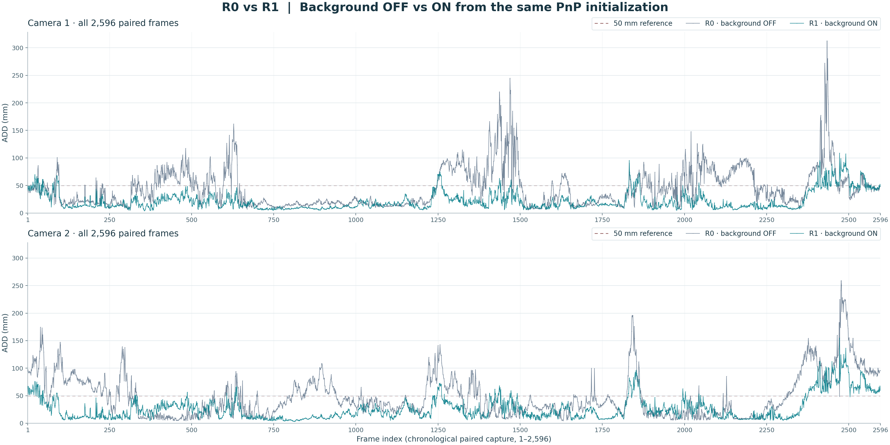

# Dual-camera robot pose estimation

동결된 로봇 관측 모델의 Candidates와 RoMa V2의 현재 두 영상 대응을 결합하는 Robotpose 확장입니다. 현재 배포에는 기반 구현과 **배경 결합 × Essential 초기화 통제 실험(2026-11-16)**이 포함됩니다.

## 전체 프레임 키포인트·포즈·ADD 시각화 (2026-11-20)

PnP 기반 초기화를 공유하는 **R0(배경 OFF) / R1(배경 ON)**의 UR_dual_2596 전체 2,596쌍을 시각화했습니다. 두 카메라 × 두 조건의 개별 이미지 **10,384개**와 프레임 탐색 HTML, 전체 프레임 ADD 그래프를 제공합니다.

- **[전체 이미지와 오프라인 뷰어 ZIP 다운로드](https://github.com/Stick-0/dual_camera_pairwise_v2/releases/download/visualization-20261120/r0-r1-full-frame-visualization.zip)** — 약 1GB. 압축을 풀고 `candidate_background_visualization_20261120/index.html`을 엽니다.
- [Release와 SHA-256 검증 파일](https://github.com/Stick-0/dual_camera_pairwise_v2/releases/tag/visualization-20261120)
- [시각화 코드·범례·실행 방법](candidate_background_visualization_20261120/README.md)
- [R0 OFF 그래프](candidate_background_visualization_20261120/figures/R0_ADD_all_frames.png) · [R1 ON 그래프](candidate_background_visualization_20261120/figures/R1_ADD_all_frames.png) · [카메라별 OFF/ON 비교](candidate_background_visualization_20261120/figures/R0_R1_ADD_comparison.png)
- [전체 프레임 ADD CSV](candidate_background_visualization_20261120/data/add_by_frame.csv)

전체 프레임 이미지는 Release ZIP에 들어 있습니다. Git clone과 GitHub의 자동 `Source code` ZIP에는 코드·문서·그래프·정적 비교 예시만 포함되므로, 오프라인 프레임 뷰어는 위 전용 ZIP으로 열어 주세요. 원래 데이터셋·가중치·캐시는 포함하지 않았습니다.

## 최신 구현과 결과

- [최신 상세 HTML 보고서](candidate_background_ablation_20261116/reports/final/ablation_report.html): 방법론, 전체 결과, 시간 블록 신뢰구간, 실패 원인, 실제 개선·악화 영상. HTML을 내려받아 브라우저에서 열면 내장된 그림과 선택형 표를 볼 수 있습니다.
- [새 실험 실행 방법](candidate_background_ablation_20261116/README.md)
- [실험 명세](candidate_background_ablation_20261116/CODEX_CANDIDATES_BACKGROUND_ABLATION.md)
- [전체·사전 적격·gate별 성능](candidate_background_ablation_20261116/reports/final/summary_metrics.csv)
- [네 대비와 신뢰구간](candidate_background_ablation_20261116/reports/final/paired_comparisons.csv)

UR_dual_2596 전체 **2,596쌍 / 5,192개 카메라 관측**을 실행했습니다. 네 조건은 같은 Candidates 관측, 반복 상한, A/G 파라미터화와 조건당 공동 시작점 하나를 사용합니다. R0/R1과 E0/E1은 각각 실제 초기 배열과 초기 책임도를 공유합니다.

| 조건 | 초기화 | 최종 배경 항 | 유효 관측 / 5,192 | ADD50 | AUC | 유효 포즈 평균 ADD |
|---|---|---|---:|---:|---:|---:|
| R0 | 로봇 단안 | OFF | 5,192 | 64.73% | 0.5643 | 46.39 mm |
| R1 | R0와 동일 | ON | 5,192 | 89.56% | 0.7581 | 24.25 mm |
| E0 | Essential + 로봇 척도 정제 | OFF | 4,990 | 62.06% | 0.5408 | 47.36 mm |
| E1 | E0와 동일 | ON | 4,926 | 84.55% | 0.7157 | 24.93 mm |

ADD50/AUC는 실패를 포함한 분모 5,192를 유지합니다. AUC는 0–100 mm, 5 mm 간격 곡선의 사다리꼴 적분을 100 mm로 나눈 값입니다. 평균 ADD는 유효 포즈 조건부 값입니다.

같은 R 초기값에서 배경 결합을 추가한 paired ADD 차이는 **−22.14 mm**(공동 유효 5,192개, 1초 시간 블록 bootstrap 95% CI −23.97~−20.37 mm)입니다. E 초기값에서도 결합은 개선됐지만 E 초기화 자체는 이번 시퀀스에서 악화됐습니다. 추가 상호작용의 CI는 0을 포함했습니다. 공통 검사 통과 후 배경 gate에 의한 추가 탈락은 0개이므로 이번 개선은 배경 gate의 선별 효과로 설명되지 않습니다. 긴 시간 상관과 평가 보정 기준의 한계는 상세 보고서에 기록했습니다.

기존 최대 3개 시작점의 Mono-Candidates와 Dual-Candidates는 보고서의 별도 참고표입니다. E1은 기존 Dual-Candidates와 같은 방법이 아닙니다.

## 기반 구현

- [기반 구현·방법론 문서](dual_camera_pairwise_v2/docs/CURRENT_IMPLEMENTATION_REPORT.html)
- [기반 확장 실행 방법](dual_camera_pairwise_v2/README.md)
- [기존 실험 집계](dual_camera_pairwise_v2/results)

원본 Robotpose 소스와 실행 환경, 검증된 관측·매칭 입력은 별도로 필요합니다. 이 저장소만 복제해서 실데이터 추론을 실행할 수 있는 독립 패키지는 아닙니다. 이번 실험은 기존 CUDA 관측·매칭 캐시를 검증해 재사용하고 CPU SciPy로 최적화했으며, 재학습·미세조정·새 후보 생성은 하지 않았습니다.

데이터셋, 모델 가중치, 실행 캐시, 대용량 pair 원시 결과와 과거 개발 사본은 새 배포에 포함하지 않습니다. 배포 사본의 경로 정리와 제외 항목은 새 확장의 배포 manifest에 기록합니다.
