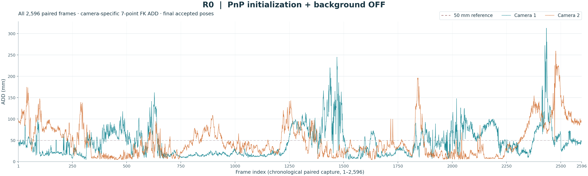
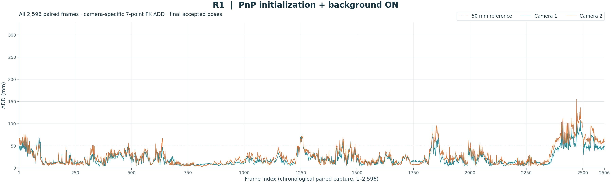
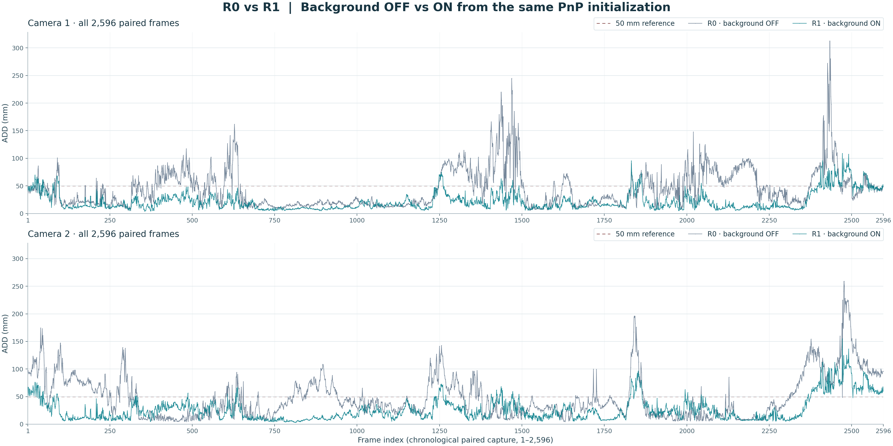
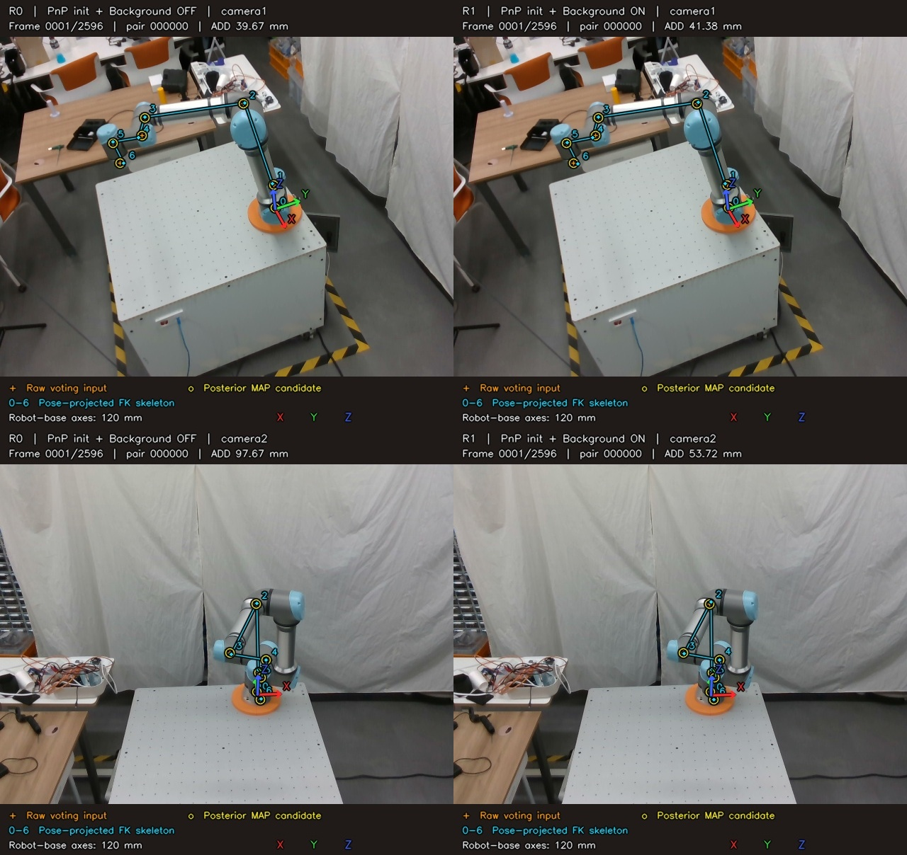
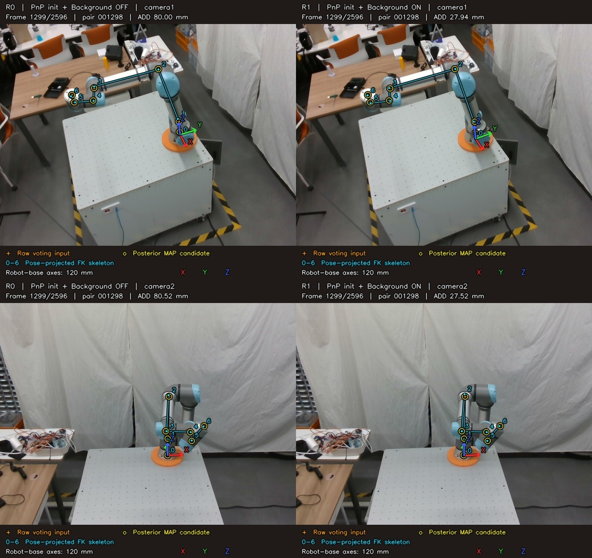
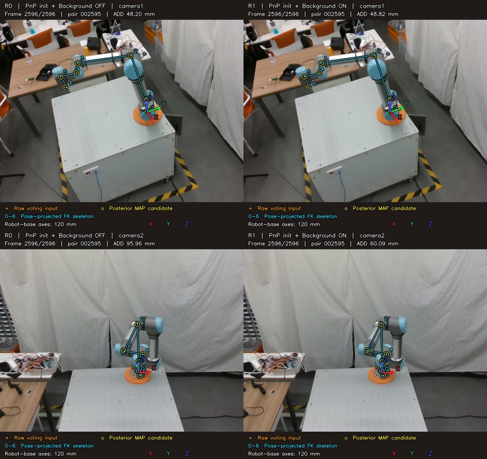
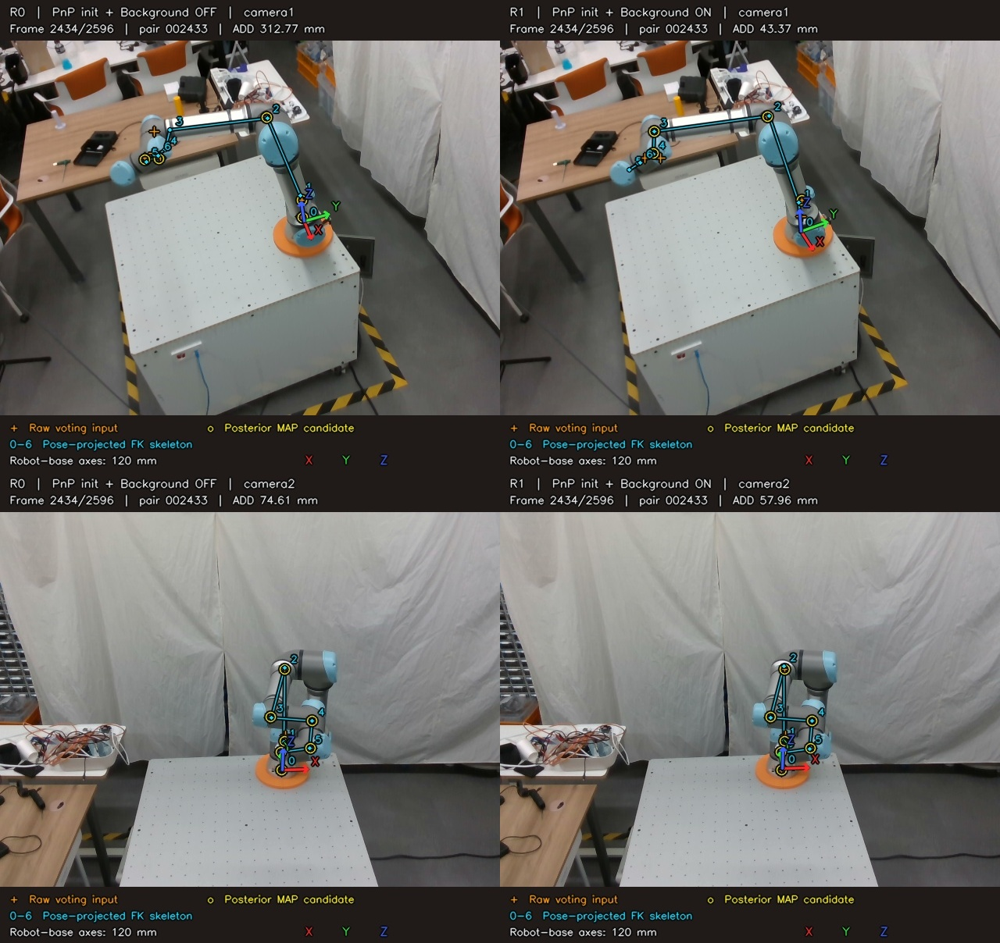
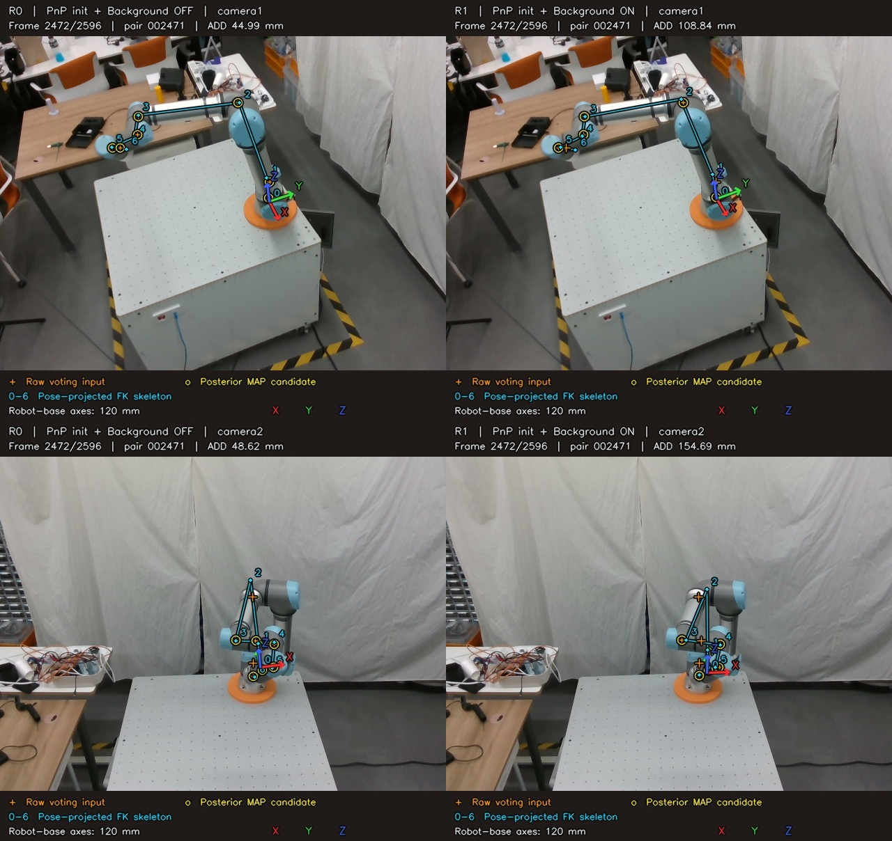

# R0 / R1 전체 프레임 키포인트·포즈·ADD 시각화

UR_dual_2596 **전체 2,596쌍 × 2카메라 × R0/R1 = 10,384개 포즈 이미지**와 전체 프레임 ADD 그래프입니다. 기존 2026-11-16 통제 실험의 저장 결과를 사용했으며, 새 모델 추론·후보 생성·매칭·PnP·최적화를 수행하지 않았습니다.

**[전체 이미지와 오프라인 뷰어 ZIP 다운로드](https://github.com/Stick-0/dual_camera_pairwise_v2/releases/download/visualization-20261120/r0-r1-full-frame-visualization.zip)** · [Release 페이지](https://github.com/Stick-0/dual_camera_pairwise_v2/releases/tag/visualization-20261120)

ZIP을 새 빈 위치에 모두 풀고 `candidate_background_visualization_20261120/index.html`을 브라우저로 열면 프레임을 이동하면서 R0/R1과 두 카메라를 비교할 수 있습니다. 폴더 구조를 유지하면 서버·인터넷·원본 데이터 없이 동작합니다. 비공개 저장소이므로 Release 다운로드에는 접근 가능한 GitHub 계정 로그인이 필요합니다. 기존 로컬 실험 폴더 위에 덮어쓰지 마세요.

Git에는 코드·뷰어·그래프·CSV·정적 비교 예시·검증 기록이 있습니다. 약 1GB의 개별 이미지 10,384개는 Release ZIP에만 있습니다. GitHub의 HTML 파일 페이지는 뷰어를 실행하지 않으며, Git clone만으로 HTML을 열면 개별 이미지 대신 다운로드 안내가 나타납니다. 원본 영상을 다시 받거나 추론을 수행할 필요는 없습니다.

## 전체 결과

R0는 PnP와 단안 Candidates 정제로 얻은 로봇 포즈 초기값에서 배경 항 없이 최적화한 조건입니다. R1은 **R0와 정확히 같은 초기 포즈**에서 배경 항을 켠 조건입니다. 두 조건 모두 본 공동 최적화 시작점은 하나이며, 기존 다중 시작점 production 결과는 섞지 않았습니다.

전체 5,192개 카메라 관측에서 R0와 R1 모두 유효 포즈를 얻었습니다. 그래프는 모든 프레임을 촬영 시간순으로 표시하며 생략·평균화·평활화·오차 상단 절단이 없습니다. 모든 그래프는 같은 y축 범위를 사용합니다. ADD는 촬영 시각별 FK 7점과 기존 평가 변환으로 계산한 mm 값입니다.







- [전체 2,596프레임 ADD CSV](data/add_by_frame.csv)
- [R0 SVG](figures/R0_ADD_all_frames.svg), [R1 SVG](figures/R1_ADD_all_frames.svg), [비교 SVG](figures/R0_R1_ADD_comparison.svg)
- [상세 범례·원래 실행 명령](README.txt)

## 실제 영상 예시

아래 사진의 행은 카메라 1/2, 열은 R0/R1입니다. 전체 이미지는 Release ZIP의 `overlays/조건/카메라/PAIR_ID.jpg`에서 확인할 수 있습니다.











주황 +는 raw voting 입력, 노란 원은 사후 MAP 후보, 청록 점/선과 0–6 번호는 최종 포즈로 투영한 FK 골격입니다. 빨강 X·초록 Y·파랑 Z는 추정된 로봇 베이스 좌표축이며 각 축 길이는 120mm입니다. MAP는 시각화를 위한 사후 선택이며 단일 MAP 점으로 포즈를 재추정한 것이 아닙니다. 실제 링크 외곽이나 메쉬는 표시하지 않습니다.

시작·중간·끝과 최대 개선/악화는 그림을 확인하기 위한 예시 선정입니다. [선정 기록](data/preview_selection.json)에 pair와 차이를 남겼으며 추정이나 튜닝에는 사용하지 않았습니다.

## 검증과 배포 범위

원래 시각화에서 10,384개 저장 포즈의 직접 재투영과 `pose_projected` 차이는 0px, 축 원점과 FK 0번 차이는 0px였습니다. 기존 ADD CSV와 재계산 차이는 최대 2.31e-13mm입니다. JPEG 전부의 디코드·SHA 및 기대 출력 집합을 확인했고 실제 읽은 7개 원본 파일과 RGB 5,192개를 전후 비교했습니다.

[원본 계산 검증](validation/preparation.json) · [원본 파일 보존·출력 검증](validation/final_verification.json) · [그래프 검증](validation/add_graphs.json) · [원본 뷰어 검사](validation/viewer_qa.json)

위 JSON은 **원래 2026-11-20 로컬 생성 실행의 검증 기록**입니다. 배포 ZIP 또는 새로운 사용자 환경을 검사한 기록으로 해석하지 않습니다. 원래 Chrome 실행은 sandbox에서 실패해 JavaScript 브라우저 실행 검증은 하지 못했으며 정적 링크·데이터·구문·그림을 검사했습니다. 개인 로컬 경로는 `${ROBOTPOSE_ROOT}`로 표기했습니다. [원본 산출물 해시](source_manifest.json)와 [배포 사본 해시·변환 목록](publication_manifest.json)을 따로 제공합니다.

`run.py`, `src/build_viewer.py`, `src/plot_frame_add.py`는 실제 실행 코드와 바이트 단위로 같습니다. 그래프 11개, ADD CSV 및 예시 선정 JSON도 그대로입니다. HTML에는 배포 설명과 이미지 파일 누락 안내만 추가했고 모든 2,596프레임 ADD 데이터와 경로를 유지했습니다. 모델·데이터셋·가중치·캐시·원본 영상·대형 준비용 JSONL·과거 출력은 Git과 Release 배포에서 제외합니다. Release 이미지는 원본 영상 위에 이미 결과가 그려진 JPEG 산출물입니다.

## 원본 환경에서 재생성

**이미 만들어진 결과 보기에는 이 단계가 필요 없습니다.** 재생성에는 원래 Robotpose 환경, `candidate_background_ablation_20261116/`의 실제 저장 결과·설정·원본 RGB·평가 기준이 필요합니다. GitHub 경량 clone에는 이 입력들이 없으므로 clone만으로 `prepare`를 실행할 수 없습니다.

원본 `candidate_background_ablation_20261116/configs/experiment.yaml`의 경로와 캐시 계약이 유효한 환경에서만 아래 명령을 실행합니다. 원래 생성기와 동일하게 폴더들이 Robotpose 바로 아래에 있어야 합니다. 기존 파일을 덮어쓰지 않도록 아직 없는 새 시각화 폴더에 코드만 복사합니다.

```bash
export ROBOTPOSE_REPO_ROOT=/path/to/Robotpose
export VIS_SOURCE=/path/to/downloaded/candidate_background_visualization_20261120
VIS="$ROBOTPOSE_REPO_ROOT/candidate_background_visualization_reproduction"
test ! -e "$VIS" || exit 1
mkdir -p "$VIS/src" "$VIS/data" "$VIS/figures" "$VIS/validation"
cp "$VIS_SOURCE/run.py" "$VIS/"
cp "$VIS_SOURCE/src/build_viewer.py" "$VIS_SOURCE/src/plot_frame_add.py" "$VIS/src/"
DCP_PY="$ROBOTPOSE_REPO_ROOT/.venv/bin/python"
"$DCP_PY" -B "$VIS/run.py" prepare
"$DCP_PY" -B "$VIS/run.py" render --output smoke --limit 4 --workers 4
"$DCP_PY" -B "$VIS/run.py" render --output overlays --workers 8
"$DCP_PY" -B "$VIS/src/plot_frame_add.py"
"$DCP_PY" -B "$VIS/src/build_viewer.py"
"$DCP_PY" -B "$VIS/run.py" verify
```

기존 NumPy·OpenCV·PyYAML·Matplotlib가 설치된 Python 환경을 사용합니다. 별도 설치나 원본 파일 변경은 하지 않습니다. 출력이 이미 있으면 새 폴더를 사용하세요. 동결된 원래 뷰어 생성기는 문서용 `README.txt`와 정적 검증 기록을 자동 생성하지 않으므로, 새 재현 결과에서는 필요한 설명 파일을 별도로 준비해야 합니다.
